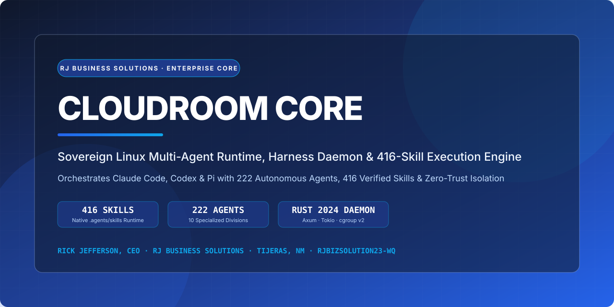
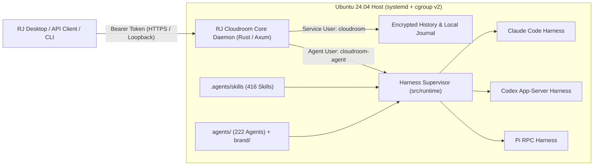

<div align="center">
  
  <br />
  <p align="center">
    <a href="https://rjbusinesssolutions.org"></a>
    <a href="https://github.com/rjbizsolution23-wq/cloudroom-core/actions"></a>
    <a href="agents/CATALOG.md"></a>
    <a href="agents/CATALOG.md"></a>
    <a href="LICENSE"></a>
  </p>
  <p align="center">
    <a href="https://rjbusinesssolutions.org"><strong>Website</strong></a> ·
    <a href="agents/CATALOG.md"><strong>Agents &amp; Skills Catalog (222 / 416)</strong></a> ·
    <a href="docs/setup.md"><strong>Ubuntu 24.04 Setup</strong></a> ·
    <a href="docs/harnesses.md"><strong>Harnesses</strong></a> ·
    <a href="docs/api.md"><strong>HTTP API</strong></a> ·
    <a href="SECURITY.md"><strong>Security</strong></a>
  </p>
</div>

---

## 🏛️ Overview

**RJ Cloudroom Core** is the sovereign Linux multi-agent execution daemon and HTTP runtime engineered by **Rick Jefferson | RJ Business Solutions**. It runs coding and enterprise agents (**Claude Code**, **Codex**, and **Pi**) on dedicated Linux infrastructure, isolates service credentials from agent execution via dual Unix accounts (`cloudroom` and `cloudroom-agent`) and `systemd` / `cgroup v2` slices, streams live JSON-RPC / SSE session events, and persists durable local and remote session history.

This edition of **RJ Cloudroom Core** comes pre-loaded with the complete **RJ Business Solutions Autonomous Intelligence Suite**:
- **416 Verified Runtime Skills** in [`.agents/skills/`](.agents/skills) (symlinked to `.claude/skills/` for zero-config harness discovery and native `<command-name>` prompt expansion via `src/runtime/claude_skills.rs`).
- **222 Autonomous Specialist Agents** in [`agents/`](agents) spanning **10 specialized enterprise divisions**, indexed in [`agents/registry.json`](agents/registry.json) and [`agents/CATALOG.md`](agents/CATALOG.md).
- **RJ Brand Universe Design System** in [`brand/`](brand) providing authoritative CSS tokens (`#2563eb`, `#0ea5e9`, `#1e3a8a`, `#0f172a`), `Space Grotesk` / `Inter` typography rules, and executive templates.

<p align="center">
  
</p>

---

## 🧠 System Architecture



---

## 🤖 Integrated Autonomous Agents & Skills (`222 Agents` · `416 Skills`)

All agent specifications and runtime skills are version-controlled directly in this repository and indexed in [`agents/CATALOG.md`](agents/CATALOG.md) and [`agents/registry.json`](agents/registry.json).

| Division | Directory | Agent Count | Core Capabilities |
| :--- | :--- | :---: | :--- |
| **Executive Directors** | [`agents/directors/`](agents/directors) | **11** | API, Backend, Content, Database, DevSecOps, Engineering, Finance, Frontend, Infrastructure, Marketing, QA & Sales Directors (NeuronEdge Labs™). |
| **Principal Engineering** | [`agents/engineering/`](agents/engineering) | **15** | Full-Stack Architecture, App Forge v2, DB Overlord v2, Stripe Nexus Payments, Twilio Master, Unreal C++ Authority, GitHub Ops Autopilot, Deep Repo Auditor. |
| **Finance, Credit & Tax** | [`agents/finance_credit_tax/`](agents/finance_credit_tax) | **6** | Credit Repair Compliant Marketing (CROA), Supreme Credit Master, Credit Oracle, Ultimate AI Tax System, Supreme Underwriting, Federal Grants & Contracts. |
| **Growth, Marketing & SEO** | [`agents/growth_marketing_sales/`](agents/growth_marketing_sales) | **21** | 50x Sales System, FunnelForge Ultra, GoHighLevel Empire Builder, Dennis Content Factory, Knowledge Panel Entity SEO, Local Google Domination, SaaS Pricing. |
| **Legal & Compliance** | [`agents/legal_compliance/`](agents/legal_compliance) | **14** | Supreme Legal AGI Master Router, M&A Deal Specialist, SEC Enforcement, Securities Compliance, Delaware Chancery, Contract Drafting, Corporate Formation, Bankruptcy. |
| **Media, Audio & Video** | [`agents/media_audio_video/`](agents/media_audio_video) | **5** | 8-Second Cinematic Ad Director, Quantum Image & Video Visuals, YouTube Intelligence Extractor, Wave Professor Music Mentor, Video SEO Optimizer. |
| **Operations & SOPs** | [`agents/operations_sop/`](agents/operations_sop) | **2** | Support Director & Universal MetaCor Template Engine v2. |
| **Master Orchestrators** | [`agents/orchestrators/`](agents/orchestrators) | **17** | RJ Prometheus Sovereign Engine, Supreme Meta AGI (Rick Mode v11/v12), DevTeam Master Orchestrator, RJ Fleet Orchestrator, SaaS Productizer, Repo Rebrander. |
| **Specialized Systems** | [`agents/specialized/`](agents/specialized) | **27** | Quantum Prompt Genesis, Authority Book Engine, White-Label Builder, Faceless Digital Empire, Men's Justice Legal Titan, KDVMA Master Sgt. |
| **Plugin Specialist Swarm** | [`agents/plugins/`](agents/plugins) | **104** | Cloudflare Architect, Security Red Team, Truth Temporal Oracle, Apex GameForge (18 agents), TubeMind YouTube Empire (19 agents), Supreme Blog Engine (13 agents). |

> 📖 **Browse the full list**: See [`agents/CATALOG.md`](agents/CATALOG.md) for links to every single agent and all **416 runtime skills** in [`.agents/skills/`](.agents/skills).

---

## ⚡ Quick Start & Installation

### 1. Automated Ubuntu 24.04 Installation

On a fresh Ubuntu 24.04 x86_64 or arm64 host with `systemd` and `cgroup v2`:

```bash
curl -fsSL https://raw.githubusercontent.com/rjbizsolution23-wq/cloudroom-core/main/install/install.sh -o install.sh
sudo bash install.sh
```

### 2. Build from Source & Provision All 416 Skills / 222 Agents

```bash
git clone https://github.com/rjbizsolution23-wq/cloudroom-core.git
cd cloudroom-core

# Build optimized release binary
cargo build --locked --release --jobs 2

# Provision all 416 skills, 222 agents, and RJ Brand tokens into the agent home directory
python3 install/provision-rj-agents.py --home ~
```

To provision directly into the isolated `cloudroom-agent` account on a production host:

```bash
sudo python3 install/provision-rj-agents.py --home /home/cloudroom-agent --user cloudroom-agent
```

### 3. Verify Build & Test Suite

```bash
cargo fmt --check
cargo clippy --locked --all-targets -- -D warnings
cargo test --locked --all-targets
python3 tests/install.py
```

---

## 📚 Documentation Index

- **[Run on Ubuntu 24.04 (`docs/setup.md`)](docs/setup.md)**: Full installation, account isolation, systemd service setup, Tailscale private HTTPS, and zero-downtime upgrades.
- **[Harnesses (`docs/harnesses.md`)](docs/harnesses.md)**: How Cloudroom Core supervises Claude Code, Codex, and Pi processes, manages credentials, and expands `.agents/skills/`.
- **[HTTP API (`docs/api.md`)](docs/api.md)**: Complete REST and Server-Sent Events (SSE) reference for threads, turns, skills sync, terminal sessions, and health checks.
- **[Session Lifecycle (`docs/session-lifecycle.md`)](docs/session-lifecycle.md)**: How threads start, stream, recover from crashes, and archive history.
- **[Storage & Disk Governance (`docs/storage.md`)](docs/storage.md)**: Disk monitoring, cgroup v2 slices, cache management, and quota-free safety thresholds.
- **[Live Previews (`docs/previews.md`)](docs/previews.md)**: Authenticated localhost port forwarding and preview proxying.
- **[Observability (`docs/observability.md`)](docs/observability.md)**: Structured diagnostics, metrics, and health reporting.
- **[Dashboard (`docs/dashboard.md`)](docs/dashboard.md)**: Built-in operator status and session inspection interface.
- **[TypeScript Client (`integrations/bb/`)](integrations/bb)**: `@cloudroom/client` TypeScript SDK for interacting with the Cloudroom Core HTTP API.

---

## 🔒 Security & Compliance

- **Privilege Separation**: The HTTP service runs as `cloudroom` while untrusted or autonomous agent workloads execute as `cloudroom-agent` inside dedicated `cgroup v2` scopes.
- **Vulnerability Disclosure**: See [`SECURITY.md`](SECURITY.md) or email [support@rjbusinesssolutions.org](mailto:support@rjbusinesssolutions.org).
- **License**: Apache-2.0 — see [`LICENSE`](LICENSE) and [`NOTICE.md`](NOTICE.md).

---

<div align="center">
  
  <p>
    <strong>Engineered by Rick Jefferson, CEO — RJ Business Solutions</strong><br />
    1342 NM 333, Tijeras, New Mexico 87059 · <a href="https://rjbusinesssolutions.org">rjbusinesssolutions.org</a> · <a href="mailto:support@rjbusinesssolutions.org">support@rjbusinesssolutions.org</a><br />
    <a href="https://www.linkedin.com/in/rick-jefferson-314998235">LinkedIn</a> · <a href="https://github.com/rjbizsolution23-wq">GitHub (@rjbizsolution23-wq)</a> · <a href="https://twitter.com/ricksolutions1">X (@ricksolutions1)</a> · <a href="https://www.tiktok.com/@rick_jeff_solution">TikTok</a>
  </p>
  <p><sub><em>RJ Business Solutions provides software and automation technology. Not financial or legal advice.</em></sub></p>
</div>
